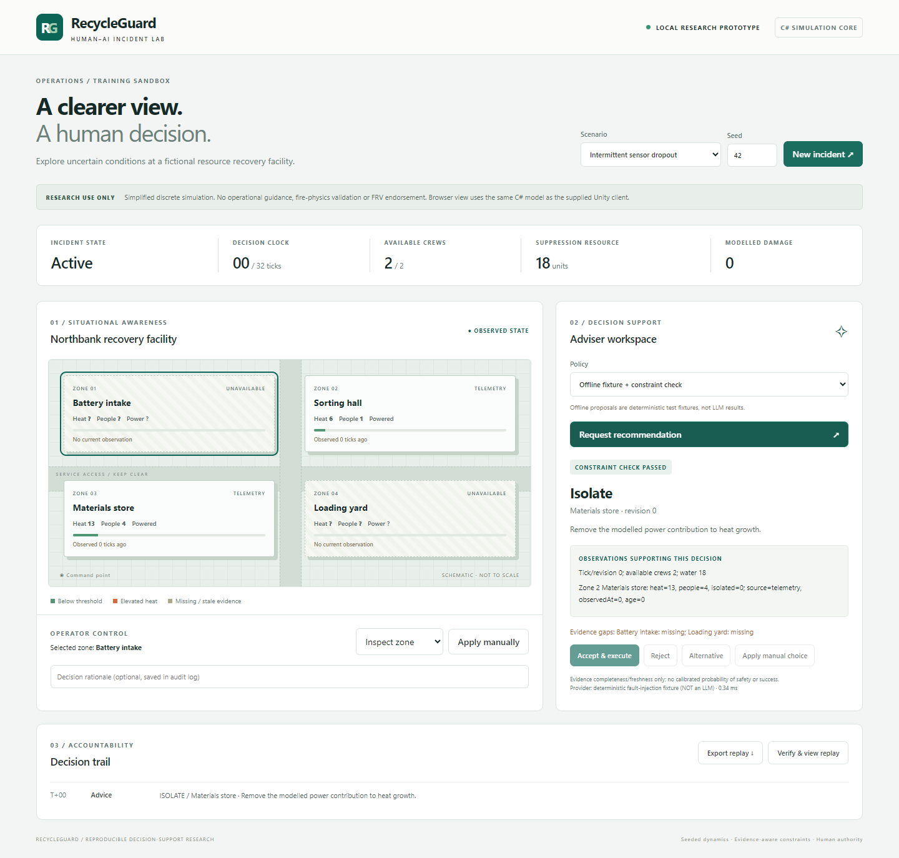
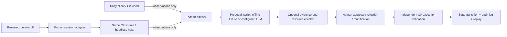

# RecycleGuard

**An inspectable emergency-training research prototype with a shared C# incident model, a Unity client, and an observation-only Python adviser.**

The operator workspace brings facility state, observation timestamps, recommendations and decision history into one view. See [interface design and verification](docs/UI_REDESIGN.md).



Fictional setting: Northbank resource recovery facility. The operator must manage escalating heat, evacuate occupants, establish modelled isolation, and allocate limited crews and suppression resource under imperfect telemetry. The operator always decides whether to accept, reject, modify or replace advice.

> **Release status:** the Windows browser demo, C# core, Python service, replay and offline experiments have been run and tested. The Unity client is supplied as source and has **not** been compiled or run in Unity. A licensed Editor on another machine or runner is still required. Offline proposal fixtures are **not LLMs**. This is a simplified research sandbox, not operational guidance or an FRV-validated system.

## Try it without installing Unity or Python

Extract `dist/RecycleGuard-Windows.zip` to a short path on Windows 10/11 x64 and run `RecycleGuard.exe`. Keep the console open. The browser opens on `http://127.0.0.1:8765`. Close the service with Ctrl+C. If the port is occupied, use `RecycleGuard.exe --port 8766`.

The portable executable includes Python, the service, the browser assets and the compiled C# core. Windows .NET Framework 4.x is required (normally present on Windows 10/11). **This executable is not a Unity player.**

Watch [the recorded browser walkthrough](artifacts/demo/RecycleGuard-browser-demo.webm). It is browser footage, not Unity footage.

## Source quick start (Windows)

Prerequisites: Python 3.12, Windows .NET Framework compiler. From the repository root:

```powershell
.\scripts\start.ps1
```

The script builds the C# host, creates a virtual environment, installs pinned direct dependencies and starts the local service. Open `http://127.0.0.1:8765`. API documentation: `/docs`.

Manual setup:

```powershell
.\scripts\build-core.ps1
python -m venv .venv
.\.venv\Scripts\python.exe -m pip install -r requirements.txt
.\.venv\Scripts\python.exe -m uvicorn adviser.app:app --host 127.0.0.1 --port 8765
```

Close running demo sessions before rebuilding the C# executable: Windows locks a running executable. The build script uses a short temporary compilation path to support workspaces with long paths.

## A five-minute walkthrough

1. Choose **Intermittent sensor dropout**, seed **42**, and start a new incident.
2. Select a zone. Missing observations display `?`; they are never silently treated as zero.
3. Request advice in **Offline fixture + constraint check** mode. Read the rationale, source timestamps and evidence gaps.
4. Request an alternative, then reject it. Observe that rejection does not advance time.
5. Try to suppress the initial battery-intake zone manually. The independent C# validator blocks it and no suppression resource is spent. An invalid current decision still costs a tick.
6. Reset and accept checked recommendations until containment. Compare with the unchecked fixture or scripted policy.
7. Export a replay. Import it using **Verify & view replay**. The C# model reruns the action sequence and compares every state before the browser enables debrief playback.

Debrief explicitly shows recorded ground truth. Live advice sees observations only. Advice, alternatives, rationale and decisions appear in the exported audit trail. Session data is held in memory until exported.

## Architecture



There is no Python copy of the simulator. `Unity/Assets/Scripts/Core/Simulation.cs` is compiled unchanged into the Unity app and the command-line host. The service uses newline-delimited JSON over standard input/output to communicate with the host.

The checked policy implements a deterministic proposal-and-check loop with priority-based repair and conditional subgoals. It is not an optimal planner, a trained reinforcement learner or a novel multi-agent algorithm. Future steps are not automatically queued.

## Validation and measured results

- [Validation inventory](docs/VALIDATION.md)
- [Held-out evaluation: 1,200 episodes](artifacts/heldout-evaluation/RESULTS.md)
- [Machine-readable tests](artifacts/test-results.xml)
- [Browser checks and screenshots](artifacts/browser/results.json)
- [Research protocol and limitations](docs/TECHNICAL_REPORT.md)

The strict checker had zero invalid attempts across the held-out episodes and equal-state probes. This is an expected consequence of explicit constraints in a synthetic model, **not** proof of real-world safety, better human decisions or LLM reasoning. The permissive-checker ablation exposes the effect of aged evidence. All four policies share the independent execution guard.

Run tests and experiments:

```powershell
python -m pytest -q --junitxml=artifacts/test-results.xml
python -m experiments.run --seeds 100 --seed-start 2000 --output artifacts/heldout-evaluation
npm install
npx playwright install chrome ffmpeg
# Start the local service in another terminal, then:
npm run test:e2e
npm run test:ux
npm run demo
```

Browser tests default to installed Chrome; set `RG_BROWSER_CHANNEL=msedge` to use Edge. `npm run demo` records a paced walkthrough; test assertions live in the separate browser test.

## Unity client and remote build

The client generates a small roofless 3D facility with storage stacks, conveyors, service lanes, zone heat markers and a command vehicle. C# owns the incident state, interaction, resource allocation, observation generation, HTTP advice calls and replay. It uses native Unity primitives and IMGUI, with no third-party art assets.

On a machine with a licensed **Unity 6 LTS** Editor and Windows build support:

1. Copy the source to a short path (for example `C:\src\RecycleGuard`). Open the `Unity` folder in Unity Hub. The project version is a compatibility baseline, not a locally validated Editor version; use an up-to-date Unity 6 LTS patch and record the exact version used.
2. Select **RecycleGuard > Create and open incident scene**.
3. Start the Python adviser service and press Play. Manual simulation also works when the adviser is offline.
4. Select **RecycleGuard > Verify C# core**, then **Build Windows demo**.
5. Alternatively run `scripts/build-unity.ps1 -UnityEditor 'C:\path\to\Unity.exe'`.
6. Run the produced player with `-rgSmoke`, inspect its screenshot, and perform the manual interaction checklist in `docs/VALIDATION.md`.

`.github/workflows/unity-licensed-runner.yml` can do the compile/build on an already licensed Windows self-hosted runner. It deliberately does not provision licenses or claim an unexecuted cloud build. See [remote build instructions](docs/UNITY_BUILD.md).

## Optional real LLM

The adapter supports an explicitly configured `/v1/chat/completions`-compatible endpoint, including a local Ollama endpoint. Configuration is through environment variables; no key is stored in the repository:

```powershell
$env:RECYCLEGUARD_LLM_URL = 'http://127.0.0.1:11434/v1'
$env:RECYCLEGUARD_LLM_MODEL = 'YOUR_INSTALLED_MODEL'
# For a provider that requires authentication, configure RECYCLEGUARD_LLM_API_KEY separately.
python -m experiments.run --llm --seeds 30 --seed-start 3000 --output artifacts/real-model
```

The model must already be available. Real-model runs fail explicitly on provider errors or malformed output; they never silently substitute offline fixtures. Temperature is requested as zero, but provider-level reproducibility is not guaranteed. The adapter has been tested against a local HTTP stub; **no real-model results are included**. See [the protocol](docs/EXPERIMENT_PROTOCOL.md) before making LLM claims.

## Repository map

| Path | Responsibility |
|---|---|
| `Unity/Assets/Scripts/Core` | Authoritative deterministic C# model and replay |
| `Unity/Assets/Scripts/Runtime` | Native Unity scene, UI, operator loop and advice integration |
| `Unity/Assets/Editor` | Scene creation, core checks and player build |
| `headless` | C# JSON-line experiment host |
| `adviser` | Typed API, observation-only policies, constraints and model adapter |
| `web` | Accessible browser operator/debrief interface |
| `experiments` | Paired-seed runs, equal-state probes, metrics and bootstrap intervals |
| `tests` | C# invariants, API workflows, provider contracts and browser automation |
| `artifacts/heldout-evaluation` | Raw traces, per-episode metrics, manifest and results |
| `docs` | Technical report, validation scope and development provenance |

## Development

See [development provenance and contribution guidelines](docs/CONTRIBUTIONS.md). Third-party design guidance and dependency notices are documented separately in [UI_REDESIGN.md](docs/UI_REDESIGN.md) and [THIRD_PARTY_NOTICES.txt](docs/THIRD_PARTY_NOTICES.txt).
